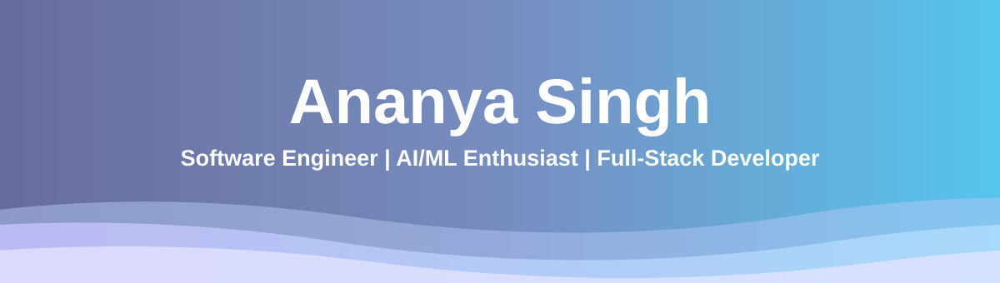

 

<b>Transforming ideas into code, intelligence into innovation, and challenges into solutions.</b>

## 👩‍💻 About Me

I'm an Information Science Engineering student interested in software engineering, artificial intelligence, and building useful applications. My projects span natural language processing, data-driven tools, and modern web development.

- 🎓 Studying **Information Science Engineering**
- 💻 Interested in **software development, AI/ML, and full-stack applications**
- 🏆 Part of **Krishi AI**, recognized with the **ISE Department Major Project Award**
- 🌱 Continuing to strengthen my problem-solving, programming, and software engineering skills
- 🤝 Interested in **software engineering internships and entry-level opportunities**
  

## ⚙️ Tech Stack

  

## 💡 Featured Projects

### 🌾 Krishi AI

**AI-Powered Agriculture Platform**

An intelligent agriculture platform designed to help farmers detect crop diseases, connect with experts, and access agricultural services through a multilingual, mobile-friendly application.

- AI-powered crop disease detection using **MobileNetV2**, classifying plant images across **15 disease categories**
- Achieved **over 90% accuracy** with disease diagnosis in under **3 seconds**
- Real-time farmer-to-expert consultation using **Firebase Firestore**
- Secure authentication with phone OTP and one-click guest login
- Offline-first **Progressive Web App (PWA)** with a **98/100 Lighthouse performance score**
- Multilingual support in **English, Hindi, and Kannada**
- Deployed on **Vercel** for seamless accessibility

`React` `Vite` `FastAPI` `TensorFlow` `Keras` `Firebase` `Node.js` `Express.js` `MongoDB` `PWA`

---

### 📰 [NewsScopeAI](https://github.com/AnanyaSingh2305/NewsScopeAi)

**AI-Powered News Intelligence Platform**

An AI-driven news analysis platform that helps users understand news through intelligent summarization, credibility assessment, political bias detection, and multilingual accessibility.

- AI-powered news analysis integrating **fake news detection, bias analysis, summarization, and translation**
- Transformer-based summarization generating article digests in under **30 seconds**
- Reduced reading time by **70%** while retaining critical information
- ML-powered credibility scoring and political bias classification
- Real-time trust metrics with **left/center/right political bias analysis**
- **6+ accessibility features**, including speech-to-text, text-to-speech, subtitles, multilingual voice output, and voice commands

`React` `Vite` `Flask` `Python` `Hugging Face` `Transformers` `OpenAI API` `gTTS` `ElevenLabs`

## Recognition

🏆 **ISE Department Major Project Award** — Krishi AI

## 📊 GitHub Activity

## 💼 What I'm Looking For

I'm actively seeking **Software Engineering, Full-Stack Development & AI/ML internship opportunities** — where I can contribute to real-world products, build scalable applications, and apply AI/ML to solve meaningful problems.

  

📬 <a href="mailto:ananyasingh5900@gmail.com">Email</a> ·
<a href="https://www.linkedin.com/in/ananya-singh-8934b4294/">LinkedIn</a> ·
<a href="https://github.com/AnanyaSingh2305">GitHub</a>

<i>Learning, building, and improving — one project at a time.</i>

